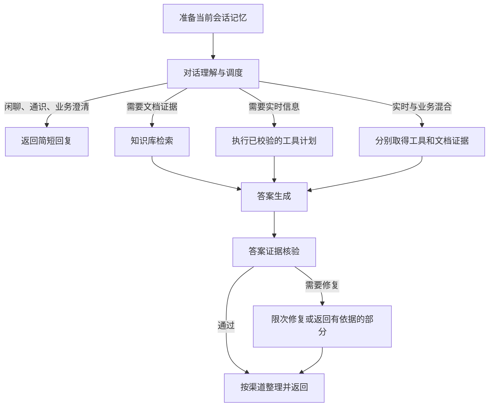

# 提示词合并与实时工具统一设计（待审核）

建议把当前10个提示词用途，以及此前拟新增的2个实时用途，收敛为7个。实时能力仍需实现工具调用；本方案调整其提示词归属，不增加独立的“实时查询规划”和“实时结果回答”菜单条目。

此文替代 [实时工具方案](realtime-tools.md) 中关于提示词拆分和规划节点的建议。实时问题直接查询、不反问、地点默认规则、来源和时效校验、固定工具响应评测等要求保持适用。本次只提交设计，不修改运行代码、数据库提示词版本或发布状态。

## 1. 七个用途及来源

| 合并后的用途 | 内部标识（建议） | 现有/拟新增来源 | 负责的行为 |
| --- | --- | --- | --- |
| 小维身份与表达 | `robot_persona` | 保留“机器人身份与表达” | 名称、口吻、简洁程度、单段纯文本；供机器人所有面向用户的回复共用。 |
| 对话理解与调度 | `conversation_plan` | 网页追问理解＋机器人追问理解＋机器人交流与分流＋拟新增实时查询规划 | 一次理解上下文、识别意图、决定业务追问、生成检索问题和实时工具参数；简单闲聊可在这次调用直接回复。 |
| 答案生成 | `answer_generate` | 网页回答＋机器人简洁回答＋拟新增实时结果回答 | 基于本轮有效的知识库或工具证据回答；网页和机器人使用各自表达方式，支持混合问题。 |
| 答案证据核验 | `review_answer` | 保留并扩展“答案证据审阅” | 独立核对答案陈述、数值、单位、引用和完整性；实时答案增加地点、时间、有效期检查。 |
| 会话记忆摘要 | `summarize` | 保留“会话摘要” | 保留用户条件、所选方案、当前话题和未解决事项，区分用户自述与旧机器人回答。 |
| 推荐问题生成 | `suggest_questions` | 保留“推荐问题” | 根据知识库资料生成可回答的问题。 |
| 推荐问题核验 | `review_suggestions` | 保留“推荐问题审阅” | 检查推荐的问题能否由对应资料完整回答。 |

数量为：1＋1＋1＋1＋1＋1＋1＝7。原10个用途中的6个（两种回答、两种追问、交流分流、身份）整理为3个（答案、调度、身份）；原有另外4个用途保留，再把两个实时用途吸收到答案和调度中。旧用途归档后只在“历史用途”中查看，不继续占用默认列表。

这既包含真正的运行职责合并，也包含同一用途下的场景规则复用。不能把旧的10份文本原封不动拼成一份巨大的提示词。

## 2. 规则各自放在哪里

“对话理解与调度”负责决定下一步：

- 公共理解：读取本会话历史，识别“那八个人呢”“明天呢”的指代，保留已知条件。
- 机器人交流：区分闲聊、通识、业务、实时以及业务澄清；问候和通识仍可一次调用完成。
- 业务条件：模糊询价、个性化推荐缺必要信息才追问；明确问单价或价格清单可直接查询，已经回答过的条件不重复问。
- 实时查询：直接规划，不追问地点和日期。地点取当前问题→当前话题→机器人配置；不可确定时返回不可用原因。日期依据后端时间和时区解释。
- 工具规划：只选择后端列出的已启用工具，输出规范参数；需要业务资料时同时生成检索问题。

“答案生成”负责如何使用已经得到的依据：

- 公共事实规则：只使用本轮有效证据，无法确认的部分明确说明。
- 网页表达：允许段落、列表、表格和代码等当前支持的格式。
- 机器人表达：引用“小维身份与表达”的同一冻结版本，保持纯文本；业务数字、单位和限制不能因为简洁而丢失。
- 实时证据：区别实况和预报，明确地点及日期，不把旧天气、静态资料或查询失败当成实时结果。
- 混合问题：把天气与有据可查的业务规则合并，标明部分可回答范围，不凭晴雨推断景区实时营业。

身份用途只负责名称、语气和表达格式，业务追问规则统一放在调度用途，不在两处重复定义。来源可信性、工具可用性和格式约束由程序验证；提示词中的偏好不能改变工具权限或绕过证据核验。

每个用途可在编辑页按上述规则分成编辑区域，整份用途仍作为一个不可变版本保存。建议新用途采用带格式版本号的结构化分区内容，沿用现有文本存储时可序列化成JSON；后台编辑表单负责读写，管理员无需手写JSON。调用时由服务端确定当前渠道及证据类型，只组合公共规则和必要分区。网页不混入机器人的纯文本规则，机器人不混入网页的表格规则。

分区属于同一用途版本，不额外生成一套隐藏的发布版本。组合器版本、使用分区及最终有效内容哈希进入快照和追踪；旧文本格式继续可读。数据库增加的归档等元数据需要迁移及 `init.sql` 同步。

## 3. 为什么保留四个公共用途

小维身份同时作用于调度中产生的闲聊/追问和检索后生成的答案。若仅塞进“机器人回答”，直接闲聊和澄清就不会统一使用；若两边复制，之后容易改漏。因此保留一处公共身份规则，调用时自动组合，不增加独立模型调用。

生成与核验继续是两次独立执行。生成节点不能自行宣称答案有依据并跳过审阅。答案核验可以同时检查文档和工具证据；推荐问题核验仍独立，因为“这段答案是否受证据支持”与“这个问题能否从资料完整回答”不是相同任务，输出和评测对象也不同。

会话摘要保留独立用途，便于单独优化压缩质量。不能把近期对话变成摘要后就视为已核实业务资料，也不能让历史天气长期作为实时证据。

如果管理上还嫌7个入口多，可把两个推荐用途放进一个可展开分组。暂不建议为凑成6个而合并两种审阅任务，也不把数量减少当作质量提升的证明。

## 4. LangGraph 调用方式

调度输出采用新的结构化协议，至少包含：`intent`、`resolved_question`、`direct_answer`、`knowledge_query`、`tool_requests`、`unavailable`。intent沿用knowledge、chat、general、realtime、clarification五种业务类型；混合问题使用realtime并同时填写knowledge_query，不另加第六种对外类型。后端按判别类型校验：纯知识不夹带工具调用；实时或混合意图不能生成反问；直接交流不能附带伪造工具结果。

例如“上海明天会下雨吗，景区雨天有什么游玩规定”，调度给出天气查询请求及业务检索问题；实际查询由后端执行。天气失败和资料不足分别处理，不能一个失败就把另一个成功结果丢弃。

网页知识问答保留知识库范围，不因共用调度提示词就自动开放闲聊或天气；渠道能力由服务端注入并校验。网页首问无历史时可保持原来的直接检索路径，不额外增加一次模型调用。机器人调用一次调度，替代现有“分流一次、带历史再理解一次”的重复处理，并吸收原计划中的实时参数规划调用。

这一合并有机会减少调用次数，但会增加单次调度任务复杂度，必须对比延迟、参数正确率和分流准确率，不能承诺合并一定更快。调度不处理文档正文，不允许无限工具循环；第一版工具规模限于天气和时间。

## 5. 提示词页面

现有页面保留，左侧从平铺列表改成4组，共7个用途：

| 页面分组 | 用途 |
| --- | --- |
| 对话与表达 | 小维身份与表达、对话理解与调度 |
| 回答与质量 | 答案生成、答案证据核验 |
| 会话记忆 | 会话记忆摘要 |
| 推荐问题 | 推荐问题生成、推荐问题核验 |

右侧仍保留版本选择、修改说明、保存草稿、试测、发布。顶部展示“用于哪些渠道/分支”，例如答案生成显示“网页、机器人、知识库、实时工具”。版本对比可明确标出本次改了公共规则、网页格式还是实时规则。

天气接口密钥、默认城市、时区、超时、缓存、工具开关放在系统配置/机器人管理；模型获得的工具协议由代码管理，参数规范由工具声明生成。这些都不变成更多管理员提示词条目。

## 6. 合并后的评测与发布

维持一个知识库一个评测集，单题测试用于调试，正式发布仍检查当前全部已启用题目和人工结论。

合并扩大了一个用途的影响范围，发布检查要从“这个key是否用过”扩展到“变更的分区和场景是否覆盖”：

- 修改答案公共规则，需要覆盖已启用的网页/机器人渠道及知识库/实时场景；修改机器人表达只要求覆盖受影响的机器人场景，但整个已启用评测集仍全部执行。
- 修改调度公共规则，要覆盖闲聊、通识、业务、历史追问、实时免追问、实时与业务混合、缺参数和工具不可用；纯网页模式不会意外产生工具请求。
- 修改摘要，要验证人数、人员构成、已选方案和待确认事项，并覆盖较长会话，而非只检查摘要有文字。
- 两侧保存相同固定时钟、地点配置和工具响应样本，不用两次实时天气结果比较提示词质量；错误参数不匹配样本时必须报告失败。

模型调用记录用途版本、实际使用分区、工具调用和证据来源。缺失受影响场景时显示“缺少实时回答测试”等明确原因，不能用“你好”的合格结果发布天气生成规则。场景覆盖按服务端能力和变更分区判定，不仅依赖候选模型自行宣称执行了哪个用途。

发布范围仍按现有规则：提示词全局共用，选择一个知识库的唯一评测集验收；本设计不擅自改成多个知识库评测集必须全部通过。

## 7. 迁移和落地顺序

1. 从数据库当前已发布版本提取规则建立映射，不能拿仓库初始种子覆盖用户后来修改的提示词。草稿、历史版本、旧实验和原人工标注保留。
2. 创建新版调度和答案用途的候选版本，以及新的结构化内容和执行协议。旧运行路径仍可按旧快照执行；旧实验不得重新解释为已经测试了新版合并提示词。
3. 实现天气/时间工具、机器人默认地点和时区配置；不猜测已有机器人的默认城市。
4. 在候选流程做固定样本对比和在线工具验证，新增测试题先作为草稿供管理员确认。旧版不支持天气时，旧版能力说明是可预期的基线，但候选必须给出有实际证据的结果。
5. 设计一次性的流程迁移验收：允许同一实验冻结旧/新各自流程版本与提示词组合，双方共享题目、时间和工具样本；验收通过后以一次事务激活新版流程及对应版本集合。现有日常发布仅允许单用途变更，不能直接拿原发布接口切换跨协议组合，也不能为迁移取消质量门槛。
6. 旧用途在默认管理列表归档，按旧ID保留可追溯性；新任务使用7个用途，正在执行的旧任务仍使用冻结组合。归档用途不再混入新版 `published_snapshot` 的用途集合，需相应调整当前严格集合校验。
7. 同步数据库迁移、`init.sql`、接口文档和评测展示。运行协议切换后，旧实验保留查看；不满足旧环境指纹的异常重测应明确提示重新建实验，不能悄悄使用新流程重放。

建议按此7用途方案实现。待验证合并后的准确率和管理体验后，再考虑是否继续合并审阅用途；第一步以去除重复规则、让实时工具自然接入并保持评测可追溯为目标。
