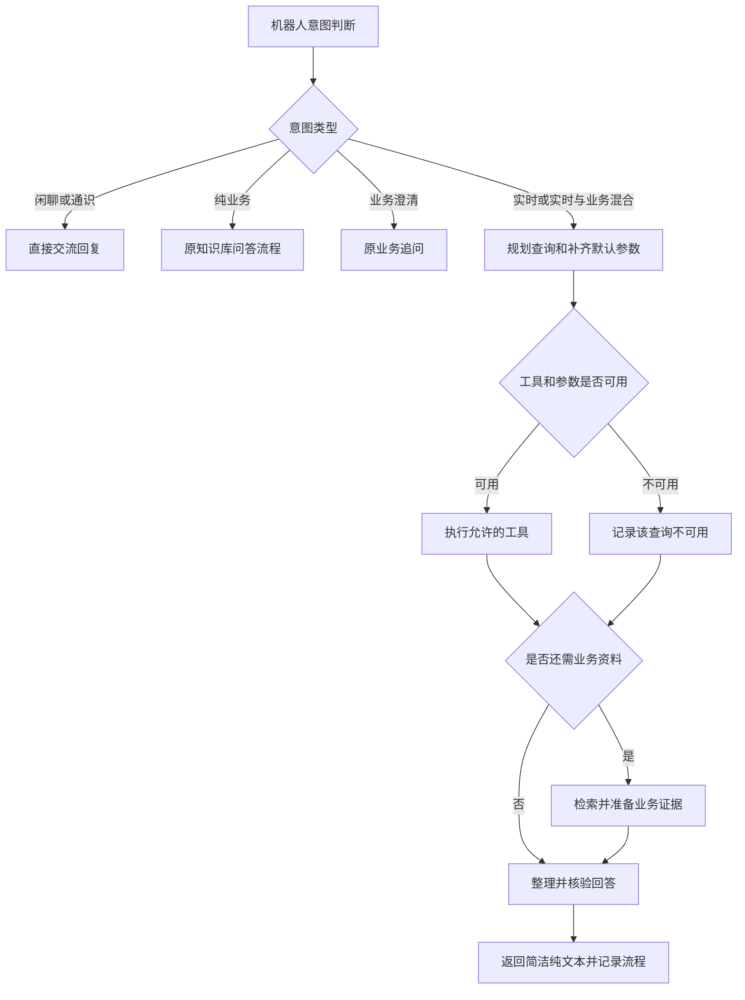

# 实时信息工具接入方案（待实现）

本方案和同目录提示词为设计草稿，尚未接入外部服务或修改数据库中的提示词版本。当前代码仍会将 `realtime` 转为固定能力说明；仅修改提示词不会使后端联网。

后续建议已整合到 [提示词合并方案](prompt-consolidation.md)：整体收敛为7个用途，实时规划并入“对话理解与调度”，实时回答并入“答案生成”，不再新增两个独立实时提示词条目。下文独立规划节点和三份草稿保留为职责与规则参考，实施时按合并方案调整；实时免追问、工具数据与评测要求继续适用。

## 使用体验

小维直接查询天气等实时信息，不就实时查询反问地点、日期或其他参数。地点顺序为：当前问题明确地点 → 同一会话当前话题明确的地点 → 机器人配置的默认地点。不能从知识库名称、其他会话或 IP 猜测位置。实际回答写明查询地点。

服务端注入当前时间和时区；“今天、明天”据此解析。没有日期时，按问题语义查询当前实况或当天预报。显式地点无法解析时不能偷偷改查默认城市；日期超出工具支持范围时不能换成其他日期。缺少可用默认值、存在无法消除的歧义或查询失败时，简短说明无法确认，不提出追问。

票价核算、个性化游玩方案等业务咨询仍可以追问必要信息。问题同时包含天气和业务时，天气部分先直接查询；业务部分有依据就回答，信息不足就说明该部分未确认，不能阻塞天气回答，也不能根据晴雨推断景区是否营业。

## 第一版范围

| 能力 | 数据来源与接入建议 |
| --- | --- |
| 当前天气、逐日预报 | 建议用和风天气一类结构化天气服务，经后端适配器接入；实际选择需确认服务覆盖、预报范围、授权与账号配置。 |
| 当前日期、时间 | 使用服务端时钟和配置的 IANA 时区，不依赖模型训练知识。 |
| 景区票价、游玩规则 | 继续查询现有知识库。静态文档中的通常开放时间不能证明今天临时营业。 |
| 实时营业、余票、实时路况 | 接入对应官方业务 API 后启用；第一版明确返回暂不支持该实时查询。 |
| 最新新闻、公开动态 | 后续增加受控网页检索；保留来源、发布时间及查询时间，不能只凭搜索摘要确认实时营业、库存或票价。 |

先实现天气和时间，可验证整个实时工具链。网页检索不是第一版必需能力。机器人请求格式仍使用现有问题、会话 ID，客户端无需新增工具参数。

## LangGraph 流程



保留现有5种 `kind`。混合请求的主分类为 `realtime`，由规划节点返回独立的 `knowledge_query`。天气失败时仍可返回有证据的业务部分，业务资料不足时仍可返回成功查询到的天气，答案标明实际可确认范围。

建议新增 `plan_realtime`、`execute_realtime_tools`、`compose_realtime` 节点。`classify_interaction` 的 realtime 分支需要移除提前生成固定答案的行为；主图不能再让 realtime 进入现有 `direct_answer`。旧冻结快照继续旧路径，避免旧任务临时混入新增提示词。

## 工具与结果约定

用 LangChain `StructuredTool` 封装固定工具，由 LangGraph 执行节点调用；模型只选择工具并提交结构化参数，地址、密钥、HTTP 调用和返回校验由后端掌握。第一版工具名为 `get_weather`、`get_local_time`。不增加任意 URL 抓取或无限自主调用循环。

规划输入包含 `question`、`history`、`runtime`、`tool_capabilities`。runtime 提供实际当前时间、时区、机器人默认地点；tool_capabilities 由后端工具注册表生成，包含已启用工具、参数约束、日期范围，不让模型假设服务存在。

规划结果示例（示例时间，运行时须替换）：

```json
{
  "requests": [
    {"name": "get_weather", "arguments": {"location": "宜宾市", "date": "2026-11-13", "mode": "daily"}}
  ],
  "knowledge_query": null,
  "unavailable": []
}
```

无支持工具时返回 `requests: []` 和结构化的 unavailable 原因，不要求用户补全信息。后端解析地点；地名有歧义且既有地区信息无法消除时返回 `ambiguous_location`。不可根据热门搜索结果随意选同名城市。

规范化的工具结果至少包含：工具名、执行状态、已解析参数、地点、时区、数据有效日期、服务商数据更新时间、后端获取时间、有效期、单位、来源标识和数据。失败必须有结构化原因，不能返回虚构的空白“成功”。提供方没有给出数据更新时间时留空，不能拿获取时间冒充。原始错误细节写诊断，机器人只收到自然简洁的说明。

执行节点验证工具允许列表、地点、日期、参数类型及服务返回。第一版建议每轮最多3个逻辑查询，单个工具调用限时5秒、仅瞬时网络故障可重试1次，总工具预算15秒。独立查询可并行，地点解析与天气获取按依赖顺序执行；达到总预算时取消剩余调用。重复天气请求可缓存5～10分钟，键包括规范地点、日期、查询模式与单位，且以提供方数据时效为上限。当天预报和当前实况不可互相替代。

简单天气可优先按已校验字段组织文本；复杂混合问题使用 `answer_realtime` 生成并核验。数字、单位、日期、地点以及营业判断必须有对应工具或文档证据。引用 ID 存在只是基础检查，还要核对陈述实际是否受对应证据支持。回复仍是1～3句、尽量120字内、最多300字的单段字符串。

## 默认位置与记忆

机器人管理增加默认地点和时区，创建或编辑时设置；不把知识库 code 当地理位置。已有机器人未设置时显示配置状态，由管理员填写真实服务地点，不能自动认定 yibin 一定代表用户所在位置。开启天气能力时建议同时配置默认地点，确保“今天天气怎么样”可以直接处理。

每轮实际使用的地点、时间基准、工具参数和证据存入本轮快照，并保留会话隔离。历史中“昨天晴天”可以作为对话背景，但不能证明今天的天气；需要实时事实时重新查询或读取仍有效的缓存。地点延续仅使用当前话题，例如讨论上海天气后问“明天呢”，继续查上海。

## 提示词管理

三份草稿随方案提供：

- `robot-interaction-realtime-draft.txt`：修改现有“机器人交流与分流”。仍使用当前三字段输出协议；实时问题直接进入 realtime，不追问，不把实时答案写在分类结果里。
- `plan-realtime-draft.txt`：拟新增“实时查询规划”，提取参数、使用默认值、选择实际存在的工具。
- `answer-realtime-draft.txt`：拟新增“实时结果回答”，根据工具和知识库证据组织小维的简洁回复。

三者在工具实现时纳入现有提示词版本管理、冻结快照、实际使用记录与发布校验。后两者目前没有对应节点，不能仅保存到提示词页面就声称工具已接入。已有 `robot_persona` 继续负责小维的身份和表达。

新提示词用途和机器人位置字段落地时补数据库迁移及 `init.sql`。现有单用途发布规则要求其他用途为已发布版本；实施时用兼容的初始用途种子完成一次功能升级，后续逐用途评测发布，不能用同时修改多份提示词的实验绕过发布约束。

## 追踪与可重复评测

LangSmith 和本地步骤记录规划、工具名称、参数、耗时、重试、缓存命中、数据更新时间、来源、结果状态，以及最终回答使用的证据。问答日志沿用现有“查看处理流程”页面展示；密钥和认证头不进入输入输出。

继续使用各知识库唯一评测集，添加以下题目，不新建第二个评测集：

| 题目或条件 | 预期行为 |
| --- | --- |
| 今天天气怎么样，机器人已配置宜宾 | 直接查询宜宾，回复包含地点，不追问。 |
| 上海明天会下雨吗 | 按上海和明天查询，使用降雨相关字段，不能查宜宾代替。 |
| 本会话刚聊上海天气，追问“后天呢” | 承接上海，将相对日期解析为确定日期后查询。 |
| 没有地点、历史地点和默认地点 | 说明暂无法确定地点并查询，不反问。 |
| 日期超出提供方预报范围 | 说明暂查不到该日期的预报，不改查今天。 |
| 明天下雨吗，景区还能玩吗 | 查询天气与景区规则，不把雨天推断成停业或营业。 |
| 景区现在还有票吗，但未接业务 API | 说明暂不能查询实时余票，不使用静态文档冒充。 |
| 工具超时、限流、地点歧义或返回过期数据 | 说明查询未成功，不猜测实时事实。 |
| 你好、为什么会下雨 | 仍走闲聊或通识，不调用天气工具。 |
| 套票多少钱，缺少必要业务条件 | 保留业务追问，不受实时查询免追问规则影响。 |

提示词对比必须使用相同的固定时钟、默认地点和工具响应样本。每道题可预置多组工具参数→结果映射；未匹配的调用记为错误，不能临时联网补齐。否则新旧提示词可能因为天气服务两次结果不同而被误判。另做在线工具可用性测试，覆盖真实服务成功、失败和延迟；线上探测不能代替固定样本的质量验收。

评测快照/环境指纹增加工具注册表版本、提供方和相关配置、工具响应样本版本、固定时间及位置。异常重测沿用本条实验的相同样本。保存各侧实际工具调用、使用的提示词、证据和来源；既评估答案，也校验参数、来源时效以及实时题没有反问。

本次只产出方案与提示词文件，没有开通外部服务、改动运行中的路由或发布提示词。

## 草稿验证记录

2026-11-12，使用项目现有模型，在内存中替换分流提示词验证9道题：无地点天气、指定城市天气、带历史的日期追问、天气与业务混合、当前时间、临时闭园、一般雨天营业规则、下雨原理、模糊询价。9道题的类型与预期一致；实时题均返回 `realtime`、`answer=null`，模糊询价仍返回业务澄清。此次仅验证分流边界，没有验证尚未实现的天气工具、参数规划或结果生成，不能代替发布验收。
