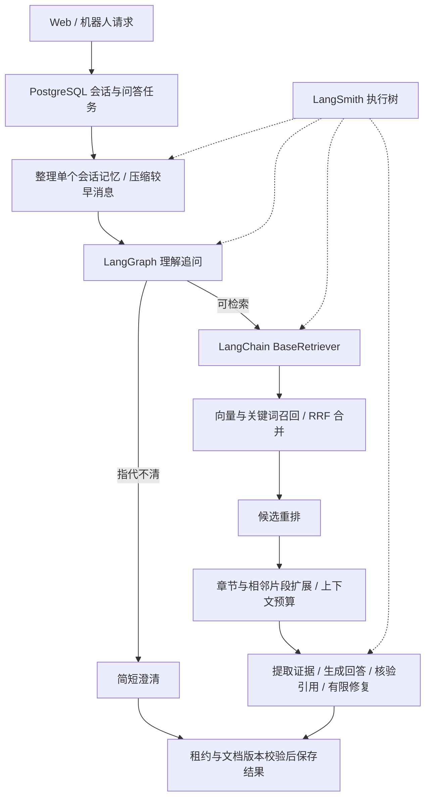

# RAG v2：实现与运行

本版把文档、检索、模型和流程接入 LangChain / LangGraph 的标准接口，并通过 LangSmith 记录每轮执行。用户会话、机器人绑定、权限、软删除、任务租约及业务历史仍保存在 PostgreSQL。检索只使用当前知识库的有效文档版本。

## 处理流程



- 文本以 LangChain `Document` 表达，`KnowledgeTextSplitter` 按章节和完整块切分，长表格重复表头，代码块保持完整；Excel 保留工作表和数据行，并识别位于合并标题之后的表头；Word 保留标题样式及中文编号章节。
- `DashScopeEmbeddings` 实现 LangChain Embeddings；保留现有百炼多模态接口、模型与维度检查、pgvector 存储。图片和视频沿用多模态索引。
- `KnowledgeBaseRetriever` 实现 `BaseRetriever`。召回、重排、章节扩展分别是 LangGraph 节点，能独立查看耗时和输入输出。默认重排是本地词汇规则；`QA_RERANK_PROVIDER=dashscope` 可启用模型重排，服务失败保留 RRF 顺序并标记降级。
- 模型使用 `ChatPromptTemplate | ChatDeepSeek.with_structured_output`，Pydantic 校验证据、回答、追问及摘要结构；关闭结构化输出开关时仍会解析和校验 JSON。模型服务异常不会触发无界重试。
- 机器人仍返回简洁纯文本；Web 仍支持 Markdown、引用、连续对话和 Word 导出。接口格式见机器人接口文档。

## 记忆与任务恢复

`prepare_context` 仅查询当前 `conversation_id` 的已完成轮次，保留最近 `QA_RECENT_TURNS` 轮，较早记录通过模型压缩为摘要。摘要保存于会话，当前轮保存上下文快照；重试复用快照，摘要失败时保留可容纳的最近消息并说明缺失。

摘要生成使用 LangChain 模型和结构化输出，并处于该轮 LangSmith 根追踪下。历史内容仅用于理解追问，不直接充当知识依据。用户删除、机器人换绑、停用、并发提交和任务租约仍由业务层检查。

当前没有额外启用 LangGraph checkpointer 或 LangChain 的会话历史存储：PostgreSQL 业务队列已经负责跨进程恢复和重复请求去重，双重持久化会引入两份历史和重复执行。LangGraph 用于有界工作流，业务数据库是会话与恢复的唯一权威。进程崩溃后重新执行本轮，不支持从任意图节点断点恢复。

## LangSmith 与问答日志

管理员入口：问答日志 → 用户或机器人 → 历史会话 → 某轮回答的“查看处理流程”。使用居中宽弹窗，关闭后保留原来的用户、会话与滚动位置。

详情包含执行树、步骤耗时、模型 token、输入输出、错误以及本地召回、重排、最终选中资料。父节点耗时包含子节点，不能累加当作总耗时。回答总耗时还包括上下文整理和业务处理。

后端接口：`GET /api/v1/admin/qa-conversations/{conversation_id}/turns/{turn_id}/trace`，要求问答日志页面权限；后端校验轮次归属，只读取数据库保存的运行编号。前端不接触 LangSmith API Key。

- `LANGSMITH_TRACING=true`、`LANGSMITH_API_KEY`：启用追踪。密钥放在未跟踪的 `.env.local` 或部署环境。
- `LANGSMITH_AGENT_ID=rag`、`LANGSMITH_AGENT_ENVIRONMENT=local`：使用 Agent 环境；留空 ID 时使用 `LANGSMITH_PROJECT`。
- `LANGSMITH_CAPTURE_CONTENT=true`：上传提示词、会话上下文、检索文本和模型输出，供管理员查看。默认模板为 false，此时仅有结构、耗时和用量，未采集的旧输入输出无法补回。
- `LANGSMITH_SAMPLING_RATE`：采样比例。未采样记录仍保留本地步骤与检索诊断。

每轮保存目的地、运行版本、提示词版本及本地诊断，失败轮次也会保存已执行的步骤。云端记录未同步、过期、未启用或服务不可用时回退到本地数据。此页最多展示 200 个步骤，单段内容最多 16000 字符，过长内容明确截取；凭据字段和 URL 签名经过过滤。远程 v2 API 使用 Agent 环境解析和带上限的查询，避免旧版读取接口找不到 Agent 记录。

目前查看的是任务结束时可用的执行记录，不是实时流式监控；尚在运行的轮次可能需要完成后刷新。

## 升级与索引

```bash
cd knowledge_back
uv sync --locked
uv run flask --app app db upgrade
uv run flask --app app rag-info
```

迁移 `b84d01e7f230` 新增 `qa_logs.execution_trace` 和文档版本的 `index_profile`、`index_config_hash`。升级后重启 Flask 和独立 Worker。前端使用 `npm run build`，Vite 开发环境自动刷新。

旧索引仍可检索。需要使用新的章节、表格和 Excel 切分时，在文档管理中执行重新索引；新上传或重新索引的版本记录实际切分策略、模型、维度、解析版本和配置哈希。部署不自动重建全部向量，也不更换现有 Embedding 模型。

## 提示词管理与页面评测

提示词已迁入 PostgreSQL，管理员通过“提示词管理”保存版本、试测与发布；“质量评测”支持保存并启用题目、固定输入的成对实验和人工复核。详见 [操作说明](prompt-evaluation-guide.md)。每个知识库唯一评测集，发布验收覆盖所选集全部已启用题目。迁移版本 `e42b6c8d901a`，全新部署的 `init.sql` 已同步。

## 命令行评测

每行一个 JSON，标注由维护者按知识库真实资料填写，例如：

```json
{"name":"景点咨询","inputs":{"question":"宜宾有哪些景点？","knowledge_base_code":"yibin","robot":false},"outputs":{"expected_document_ids":["填写本知识库真实文档 UUID"],"answer_points":["填写应覆盖的事实"],"expected_status":"SUCCESS"}}
```

```bash
uv run flask --app app rag-evaluate --dataset evaluation.jsonl --report report.json --retrieval-only
uv run flask --app app rag-evaluate --dataset evaluation.jsonl --report report.json
uv run flask --app app rag-evaluate --dataset evaluation.jsonl --publish --dataset-name my-rag-evaluation-v1
```

本地评测报告包含文档 Recall/Precision@10、MRR、状态准确率、答案要点字面覆盖率和引用文档准确率；没有金标的指标不计算。字面覆盖率不等于语义正确性。`--publish` 显式上传完整样本和标注并运行 LangSmith 实验，需要独立数据集名称，避免覆写现有金标。没有内置伪造评分或用模型自行生成金标。
