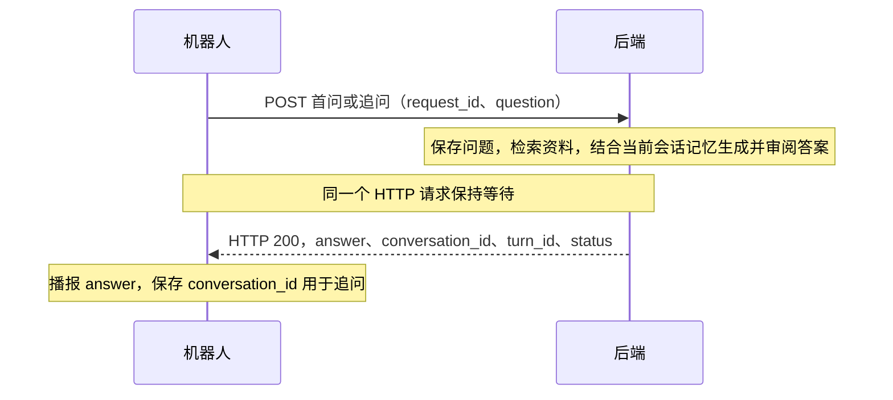

# 机器人问答接口接入文档

本文对应当前同步问答实现，包含接口地址、请求字段、完整响应示例及客户端处理步骤。所有 JSON 示例均为格式示例；其中 UUID、时间、耗时和答案不代表真实记录，接入时必须使用服务器实际返回的值。

## 1. 接口地址与接入前提

完整接口地址 = **后端服务地址 + 接口路径**。本机开发时后端默认地址为 `http://127.0.0.1:5000`。

| 功能 | HTTP 方法 | 接口路径 |
|---|---|---|
| 开启新对话并提交第一个问题 | POST | `/api/v1/robot/query` |
| 在已有对话中继续提问 | POST | `/api/v1/robot/conversations/query` |
| 兼容查询（正常接入无需调用） | GET | `/api/v1/robot/conversations/{conversation_id}/turns/{turn_id}` |
| 重试最后一轮失败的回答 | POST | `/api/v1/robot/conversations/{conversation_id}/turns/{turn_id}/retry` |
| 软删除对话 | DELETE | `/api/v1/robot/conversations/{conversation_id}` |

两个问答接口分别负责首问和追问，均在同一次请求中等待并返回最终答案。机器人正常接入无需轮询；查询接口仅作为已有客户端的兼容入口保留。

本机首问完整地址为 `http://127.0.0.1:5000/api/v1/robot/query`。机器人与后端不在同一台机器时，将 `127.0.0.1` 替换为机器人能访问的后端服务器 IP 或域名。例如后端服务器地址为 `192.168.1.100` 时，首问地址为 `http://192.168.1.100:5000/api/v1/robot/query`；此 IP 仅作示例。机器人上的 `127.0.0.1` 指向机器人自身。

后端必须监听机器人可访问的网络接口。本地联调可用 `uv run flask --app app run --host 0.0.0.0 --port 5000`；正式部署使用实际网关地址。`0.0.0.0` 是监听地址，不能直接填作机器人的服务地址。这里的 `5000` 是后端端口，前端页面的 `5173` 不作为机器人直连接口地址。

前提：机器人已注册、状态为 `active`，且绑定的知识库处于启用状态。现有机器人序列号为 `w1-025-177`，已绑定 `yibin`。接口从服务端绑定读取知识库，机器人无需也不能在提问请求里传 `knowledge_base_code` 或 `knowledge_base_id`。

当前身份识别沿用机器人序列号，无需网页用户的 Bearer Token，也未新增机器人 API Key。首问、追问推荐在 JSON 中传 `serial_no`；GET 查询、重试和删除推荐使用 `X-Robot-Serial` 请求头。

无需实体机器人也可以联调：管理员登录网页后，打开“机器人问答”（`/robot-qa`），选择已绑定知识库的机器人。页面直接调用本文的首问、追问和重试接口，并原样展示 `data.answer` 的纯文本。新对话使用新的请求编号；超时后点击“继续等待回答”复用原请求，不重复建会话。历史支持查看、续问及软删除，记录归属所选机器人，在问答日志的机器人对话中可查看。普通用户默认没有此页面权限。

## 2. 调用方式：发送一次请求，等待最终回复

机器人只需要发送首问或追问请求，并保持该 HTTP 连接直到返回；后端在这个请求里等待检索、模型生成和证据审阅完成，直接返回答案。机器人不需要定时查询状态。



后台仍保存执行状态、会话记忆和结果，保证断线重试及并发去重。网页继续使用原异步提交方式；本次同步协议针对机器人。

默认最长等待 **180 秒**，由后端 `ROBOT_ANSWER_WAIT_SECONDS` 配置（1–600 秒）。机器人客户端读取超时建议设为 **210 秒或更长**，网关和应用服务请求超时也应覆盖这个等待时长；超时处理见第 6、10 节。本文 curl 示例使用 `--max-time 210`。

## 3. ID、请求头和统一响应

### 3.1 四类 ID 不要混用

| 字段 | 谁生成 | 用途 |
|---|---|---|
| `conversation_id` | 后端 | 一整段连续对话的 ID；保持不变才能沿用这段对话的记忆 |
| `turn_id`（等于响应 `data.id`） | 后端 | 某一轮问答的 ID；用于查询答案和重试这一轮 |
| 提问 JSON 的 `request_id`，以及响应的 `data.request_id` | 机器人 | 本次问题的去重编号；新问题生成新编号，网络超时重发同一问题时保留原编号 |
| 响应最外层的 `request_id`，以及 `X-Request-ID` | 后端默认生成，也可由调用方在请求头指定 | 单次 HTTP 调用的追踪编号，方便排查问题；不负责问答去重 |

例如，超时后重发同一问题，`data.request_id` 保持原问题编号，最外层 `request_id` 可以不同。只传 `X-Request-ID` 不能替代提问 JSON 中必填的 `request_id`。

业务 `request_id` 在整个系统中唯一，推荐每个新问题使用随机 UUID。它必须为 1–100 个字符，只能包含英文字母、数字、`.`、`_` 和 `-`。

### 3.2 通用请求头

| 请求头 | 要求 |
|---|---|
| `Content-Type: application/json` | 发送 JSON 请求体时必需 |
| `X-Robot-Serial: w1-025-177` | GET 查询、重试和删除按本文示例必传；首问/追问已在 JSON 中传 `serial_no` 时可省略 |
| `X-Request-ID: trace-poll-001` | 可选，HTTP 追踪号，格式为 1–100 个字母、数字、`.`、`_`、`-` |

代码也支持首问/追问使用 `X-Robot-Serial` 代替 JSON 的 `serial_no`；两处都传时，JSON 字段优先。建议采用文档中的固定方式，避免发送不一致的序列号。序列号不能通过 GET URL 查询参数替代请求头。

### 3.3 响应外层

所有正常业务响应均为 JSON，包含 `code`、`message`、`request_id`、`data` 四个字段：

| 字段 | 类型 | 说明 |
|---|---|---|
| `code` | integer | `0` 表示本次 API 调用成功，非零表示接口错误 |
| `message` | string | 成功通常为 `ok`，错误时为原因说明 |
| `request_id` | string | HTTP 追踪编号，不是问题去重编号 |
| `data` | object 或 null | 成功时是业务数据，接口错误时为 `null` |

机器人首问、追问和重试在任务结束后返回 HTTP `200`，不会要求客户端处理 `202` 或轮询。**HTTP `200` 与 `code=0` 表示已取得终态结果，还必须检查 `data.status` 区分回答成功、资料不足和任务失败。** 等待超时返回 HTTP `504 / code=50401`，详见第 6 节。

### 3.4 答案是简洁的单段字符串

直接读取 `data.answer` 即可。机器人使用专用提示词，通常用 1～3 句话、尽量在 120 字以内回答当前问题；复杂问题保留必要条件，生成的正文最多 300 字。部分回答、资料覆盖范围等必要说明另计。答案不包含表格、标题、列表编号、Markdown 排版或来源引用，也不会返回嵌套的答案对象或数组。多段内容会整理成一个没有换行和制表符的纯文本字符串。

例如 `data.answer` 的值为：

```text
先检查电源和接地，确认连接线完好后接通电源。状态灯亮起后即可开始操作。
```

模型生成表格、代码块或过长内容时，后端会要求改写，再进行证据核对，不会直接截断答案。失败时返回简短说明。接口外层仍是 JSON，包含续问需要的 `conversation_id` 等字段；客户端无需自行解析 Markdown。首问、追问和失败重试都遵守此规则，已有答案重取时清理排版，不重新调用模型压缩内容。

## 4. 开启新对话并提问

### 请求

`POST /api/v1/robot/query`

请求头：`Content-Type: application/json`。请求体：

```json
{
  "serial_no": "w1-025-177",
  "request_id": "fc5572b7-8aeb-4c65-afd3-cfb6a2092f85",
  "question": "介绍一下蜀南竹海"
}
```

| 字段 | 类型 | 必填 | 说明 |
|---|---|---|---|
| `serial_no` | string | 是，或使用请求头替代 | 注册的机器人序列号，去除首尾空白后长度 1–100 |
| `request_id` | string | 是 | 新问题的唯一编号，超时重发必须复用 |
| `question` | string | 是 | 去除首尾空白后为 1–2000 个字符；允许换行和制表符，不允许其他控制字符 |

这个接口不接收 `conversation_id`，也不接收知识库字段。多传未定义字段会返回 HTTP `422`。服务端在同一事务中创建会话和第一轮问题。

可直接修改服务地址后联调：

```bash
curl --max-time 210 --request POST 'http://127.0.0.1:5000/api/v1/robot/query' \
  --header 'Content-Type: application/json' \
  --header 'X-Request-ID: trace-new-001' \
  --data '{"serial_no":"w1-025-177","request_id":"fc5572b7-8aeb-4c65-afd3-cfb6a2092f85","question":"介绍一下蜀南竹海"}'
```

### 完整响应示例：同一次请求返回最终答案

HTTP `200`：

```json
{
  "code": 0,
  "message": "ok",
  "request_id": "trace-new-001",
  "data": {
    "conversation": {
      "id": "11111111-1111-4111-8111-111111111111",
      "title": "介绍一下蜀南竹海",
      "source_type": "ROBOT",
      "user_id": null,
      "robot_id": "33333333-3333-4333-8333-333333333333",
      "owner_name": "W1导览机器人",
      "knowledge_base_id": "44444444-4444-4444-8444-444444444444",
      "knowledge_base_name": "宜宾知识库",
      "knowledge_base_status": "active",
      "last_turn_no": 1,
      "turn_count": 1,
      "created_at": "2026-11-09T08:00:00+00:00",
      "last_message_at": "2026-11-09T08:00:00+00:00",
      "deleted_at": null,
      "closed_at": null,
      "closed_reason": null
    },
    "id": "22222222-2222-4222-8222-222222222221",
    "turn_id": "22222222-2222-4222-8222-222222222221",
    "conversation_id": "11111111-1111-4111-8111-111111111111",
    "turn_no": 1,
    "request_id": "fc5572b7-8aeb-4c65-afd3-cfb6a2092f85",
    "question": "介绍一下蜀南竹海",
    "answer": "蜀南竹海位于四川宜宾，是以竹林景观为特色的旅游目的地。",
    "status": "SUCCESS",
    "answer_kind": "knowledge",
    "answer_status": "answered",
    "sources": [],
    "model_name": "deepseek-chat",
    "latency_ms": 2850,
    "retrieval_count": 5,
    "error_message": null,
    "created_at": "2026-11-09T08:00:00+00:00",
    "context_notice": null
  }
}
```

收到后保存 `data.conversation_id`、`data.turn_id`、`data.turn_no`，直接读取 `data.answer`。相同问题的网络重试复用原 `request_id`：已完成时返回原结果，仍在执行时继续等待，不增加会话或轮次。

## 5. 在已有对话中继续提问

### 请求

`POST /api/v1/robot/conversations/query`

请求头：`Content-Type: application/json`。请求体：

```json
{
  "serial_no": "w1-025-177",
  "conversation_id": "11111111-1111-4111-8111-111111111111",
  "request_id": "dc790d81-b5ab-49cb-9652-d2d00ac5a434",
  "question": "那里怎么去？",
  "expected_last_turn_no": 1
}
```

| 字段 | 类型 | 必填 | 说明 |
|---|---|---|---|
| `serial_no` | string | 是，或使用请求头替代 | 当前机器人序列号 |
| `conversation_id` | string（UUID） | 是 | 首问返回的会话 ID，必须属于当前机器人 |
| `request_id` | string | 是 | 这次追问的新编号，不能沿用上一问题的编号 |
| `question` | string | 是 | 本轮追问，校验规则与首问相同 |
| `expected_last_turn_no` | integer | 否 | 发送前最后已知的轮次，非负整数；例如已提交第 1 轮，续问时传 `1` |

正常等上一个提问请求返回后再提交追问，否则返回 `409 / 40902`。携带会话 ID 后，后端自动读取该会话的历史及摘要；不需要机器人上传旧问题、旧答案或 `messages`。

`expected_last_turn_no` 用于检测多个客户端同时使用同一会话的情况。若不传则不做客户端轮次比对，但仍禁止同一会话同时处理多个问题。失败轮次也占轮号，应使用服务端返回的 `turn_no`，不要只统计成功答案。

### 完整响应示例：第 2 轮回答完成

HTTP `200`：

```json
{
  "code": 0,
  "message": "ok",
  "request_id": "trace-next-001",
  "data": {
    "conversation": {
      "id": "11111111-1111-4111-8111-111111111111",
      "title": "介绍一下蜀南竹海",
      "source_type": "ROBOT",
      "user_id": null,
      "robot_id": "33333333-3333-4333-8333-333333333333",
      "owner_name": "W1导览机器人",
      "knowledge_base_id": "44444444-4444-4444-8444-444444444444",
      "knowledge_base_name": "宜宾知识库",
      "knowledge_base_status": "active",
      "last_turn_no": 2,
      "turn_count": 2,
      "created_at": "2026-11-09T08:00:00+00:00",
      "last_message_at": "2026-11-09T08:01:00+00:00",
      "deleted_at": null,
      "closed_at": null,
      "closed_reason": null
    },
    "id": "22222222-2222-4222-8222-222222222222",
    "turn_id": "22222222-2222-4222-8222-222222222222",
    "conversation_id": "11111111-1111-4111-8111-111111111111",
    "turn_no": 2,
    "request_id": "dc790d81-b5ab-49cb-9652-d2d00ac5a434",
    "question": "那里怎么去？",
    "answer": "可以先到宜宾，再根据出发位置选择前往蜀南竹海的交通路线。你计划从哪里出发？",
    "status": "SUCCESS",
    "answer_kind": "knowledge",
    "answer_status": "answered",
    "sources": [],
    "model_name": "deepseek-chat",
    "latency_ms": 3200,
    "retrieval_count": 4,
    "error_message": null,
    "created_at": "2026-11-09T08:01:00+00:00",
    "context_notice": null
  }
}
```

`conversation_id` 与首问相同，`turn_id` 是新的，`turn_no` 增加。直接读取本次返回的 `answer`。再次重发同一追问的 `request_id` 不会增加轮次。

## 6. 返回状态、失败及等待超时

正常首问、追问和失败重试返回时已处于终态，均为 HTTP `200`。请判断 `data.status`：

| status | 含义 | 客户端动作 |
|---|---|---|
| SUCCESS | 回答或澄清完成 | 播报 `answer`，保存会话 ID |
| PARTIAL | 只有部分依据 | 播报答案中的范围说明 |
| NO_EVIDENCE / SOURCES_ONLY | 缺少可靠文字依据 | 播报资料不足说明 |
| FAILED | 回答生成失败 | 展示 `error_message`，按需重试最后一轮 |
| CANCELLED | 任务取消 | 展示原因，按需开启新会话 |

`answer_kind=clarification` 表示系统需要澄清，例如“你指的是哪个景点？”。用户补充后，通过追问接口继续同一会话。

### 完整响应示例：回答生成失败

HTTP `200`，`code=0` 表示成功取得结果，`status=FAILED` 表示本轮回答失败：

```json
{
  "code": 0,
  "message": "ok",
  "request_id": "trace-poll-003",
  "data": {
    "id": "22222222-2222-4222-8222-222222222221",
    "turn_id": "22222222-2222-4222-8222-222222222221",
    "conversation_id": "11111111-1111-4111-8111-111111111111",
    "turn_no": 1,
    "request_id": "fc5572b7-8aeb-4c65-afd3-cfb6a2092f85",
    "question": "介绍一下蜀南竹海",
    "answer": null,
    "status": "FAILED",
    "answer_kind": "knowledge",
    "answer_status": "insufficient_evidence",
    "sources": [],
    "model_name": null,
    "latency_ms": 60000,
    "retrieval_count": null,
    "error_message": "问答暂时不可用，请稍后重试",
    "created_at": "2026-11-09T08:00:00+00:00",
    "context_notice": null,
    "conversation": {
      "id": "11111111-1111-4111-8111-111111111111",
      "title": "介绍一下蜀南竹海",
      "source_type": "ROBOT",
      "user_id": null,
      "robot_id": "33333333-3333-4333-8333-333333333333",
      "owner_name": "W1导览机器人",
      "knowledge_base_id": "44444444-4444-4444-8444-444444444444",
      "knowledge_base_name": "宜宾知识库",
      "knowledge_base_status": "active",
      "last_turn_no": 1,
      "turn_count": 1,
      "created_at": "2026-11-09T08:00:00+00:00",
      "last_message_at": "2026-11-09T08:00:00+00:00",
      "deleted_at": null,
      "closed_at": null,
      "closed_reason": null
    }
  }
}
```

### 完整响应示例：等待超过上限

HTTP `504`：

```json
{
  "code": 50401,
  "message": "等待回答超时，请使用相同 request_id 重发原问题获取结果",
  "request_id": "trace-timeout-001",
  "data": null
}
```

这不表示问题被删除或需要重新建会话。使用原接口和完全相同的业务 `request_id`、问题及会话 ID 重发：已完成则直接返回原答案，未完成则继续等待。无需调用轮询接口。

会话被删除、机器人停用或换绑时，等待中的请求可能直接返回 `404`、`403` 或 `409`。同步返回前会重新校验状态。

## 7. 响应字段说明

### 每一轮问答的数据字段

首问、追问和失败重试在返回时均包含下列字段及 `conversation` 对象。

| 字段 | 类型 | 含义 |
|---|---|---|
| `id` | string（UUID） | 本轮 ID，与 `turn_id` 相同 |
| `turn_id` | string（UUID） | 查询/重试路径使用的本轮 ID |
| `conversation_id` | string（UUID） | 所属会话 |
| `turn_no` | integer | 从 1 开始的轮次 |
| `request_id` | string | 提交此问题时的业务去重编号 |
| `question` | string | 本轮原始问题，首尾空白已去除 |
| `answer` | string 或 null | 简洁的单段纯文本，无表格、标题、列表和 Markdown 排版；失败或取消时可能为 null |
| `status` | string | 终态，见第 6 节；机器人正常同步响应不会返回排队或处理中状态 |
| `answer_kind` | string | `knowledge` 知识回答，或 `clarification` 澄清问题 |
| `answer_status` | string | 回答分类，映射规则见下文；不能用它判断任务是否完成 |
| `sources` | array | 机器人接口固定为 `[]`，原始来源仍保留供管理员审计 |
| `model_name` | string 或 null | 使用的模型名；未调用、尚未完成或部分特殊分支可能为 null |
| `latency_ms` | integer 或 null | 本次后台处理耗时，单位毫秒，不含首次排队时间 |
| `retrieval_count` | integer 或 null | 检索计数；尚未产出结果时可能为 null |
| `error_message` | string 或 null | 失败或取消原因，正常时通常为 null |
| `created_at` | string | ISO 8601 时间，按返回的时区偏移解析 |
| `context_notice` | string 或 null | 历史上下文未能完整覆盖等提示，非空时应提示用户补充必要信息 |

当前 `answer_status` 的实际映射为：`SUCCESS → answered`、`PARTIAL → partial`、`SOURCES_ONLY → sources_only`，其他状态均为 `insufficient_evidence`。失败或取消时也可能出现 `insufficient_evidence`，请先按 `status` 处理任务错误，不能将它误播报成“资料不足”。

`NO_EVIDENCE` 的机器人答案为“当前资料不足，暂时无法回答。”；`SOURCES_ONLY` 为“暂时无法整理出可靠回答，请换个问法。”

### 首问、追问和重试返回的 `conversation`

| 字段 | 类型 | 含义 |
|---|---|---|
| `id` | string（UUID） | 会话 ID，等于外层 `data.conversation_id` |
| `title` | string | 由首问截取的标题 |
| `source_type` | string | 机器人会话固定为 `ROBOT` |
| `user_id` | null | 机器人会话不属于网页用户 |
| `robot_id` | string（UUID） | 机器人在数据库中的 ID，与序列号不同 |
| `owner_name` | string | 机器人显示名称 |
| `knowledge_base_id` | string（UUID） | 创建该会话时绑定的知识库 ID；只读信息，无需回传 |
| `knowledge_base_name` | string | 知识库名称 |
| `knowledge_base_status` | string | 正常可提问时为 `active` |
| `last_turn_no` | integer | 当前已提交的最后轮次 |
| `turn_count` | integer | 已提交轮次总数，包括失败/取消轮次 |
| `created_at` | string | 会话创建时间，ISO 8601 |
| `last_message_at` | string | 最后一次提交新问题的时间，ISO 8601 |
| `deleted_at` | string 或 null | 软删除时间，未删除为 null |
| `closed_at` | string 或 null | 关闭时间，未关闭为 null |
| `closed_reason` | string 或 null | 关闭原因，例如换绑时 `knowledge_base_changed` |

同一 `request_id` 重复提交时，`data.turn_no` 仍指原问题，但 `conversation.last_turn_no` 可能反映后来提交的轮次；客户端应区分“本轮信息”和“会话当前信息”。

## 8. 重试最后一轮失败回答

### 请求

```http
POST /api/v1/robot/conversations/11111111-1111-4111-8111-111111111111/turns/22222222-2222-4222-8222-222222222221/retry
Content-Type: application/json
X-Robot-Serial: w1-025-177
X-Request-ID: trace-retry-001

{}
```

仅最后一轮 `FAILED` 可重新执行；JSON 使用空对象。此请求也会等待最终结果，保留原 `turn_id`、`turn_no` 和业务 `request_id`。同一轮已在处理时，重复重试请求等待正在执行的结果，不创建重复任务。

### 完整响应示例：重试成功

HTTP `200`：

```json
{
  "code": 0,
  "message": "ok",
  "request_id": "trace-retry-001",
  "data": {
    "conversation": {
      "id": "11111111-1111-4111-8111-111111111111",
      "title": "介绍一下蜀南竹海",
      "source_type": "ROBOT",
      "user_id": null,
      "robot_id": "33333333-3333-4333-8333-333333333333",
      "owner_name": "W1导览机器人",
      "knowledge_base_id": "44444444-4444-4444-8444-444444444444",
      "knowledge_base_name": "宜宾知识库",
      "knowledge_base_status": "active",
      "last_turn_no": 1,
      "turn_count": 1,
      "created_at": "2026-11-09T08:00:00+00:00",
      "last_message_at": "2026-11-09T08:00:00+00:00",
      "deleted_at": null,
      "closed_at": null,
      "closed_reason": null
    },
    "id": "22222222-2222-4222-8222-222222222221",
    "turn_id": "22222222-2222-4222-8222-222222222221",
    "conversation_id": "11111111-1111-4111-8111-111111111111",
    "turn_no": 1,
    "request_id": "fc5572b7-8aeb-4c65-afd3-cfb6a2092f85",
    "question": "介绍一下蜀南竹海",
    "answer": "蜀南竹海位于四川宜宾，是以竹林景观为特色的旅游目的地。",
    "status": "SUCCESS",
    "answer_kind": "knowledge",
    "answer_status": "answered",
    "sources": [],
    "model_name": "deepseek-chat",
    "latency_ms": 3000,
    "retrieval_count": 5,
    "error_message": null,
    "created_at": "2026-11-09T08:00:00+00:00",
    "context_notice": null
  }
}
```

已经成功、已取消或不是最后一轮时再次调用 `/retry` 返回 `409`；读取已有结果可重发原提问请求。`/retry` 超过等待上限也返回 `504 / 50401`。

## 9. 软删除会话

### 请求

```http
DELETE /api/v1/robot/conversations/11111111-1111-4111-8111-111111111111
X-Robot-Serial: w1-025-177
X-Request-ID: trace-delete-001
```

不发送请求体。只能删除当前机器人自己的会话。删除会取消未完成问题，后续提问和查询返回会话不存在；管理员仍能查看审计历史。

### 完整响应示例

HTTP `200`：

```json
{
  "code": 0,
  "message": "ok",
  "request_id": "trace-delete-001",
  "data": {
    "id": "11111111-1111-4111-8111-111111111111",
    "deleted": true
  }
}
```

同一机器人重复删除同一会话仍可返回此成功结果。删除后清除客户端当前 `conversation_id` 和当前 `turn_id`。

“开启新对话”不要求删除旧会话：给首问接口发送一个新的 `request_id` 即可。只有用户希望移除历史时才调用删除接口。

## 10. 错误响应及重试规则

### 完整接口错误示例：机器人换绑后仍使用旧会话

HTTP `409`：

```json
{
  "code": 40912,
  "message": "机器人知识库绑定已变更，请开启新对话",
  "request_id": "trace-next-error-001",
  "data": null
}
```

这类错误没有 `data.status`，因为接口请求没有被正常受理。与第 6 节“HTTP 200、`data.status=FAILED`”的回答生成失败不同。

| HTTP | `code` | 含义与处理 |
|---|---|---|
| 422 | 42201 | 缺失字段、类型/长度错误、JSON 不是对象、携带未定义字段等；修改请求 |
| 403 | 43001 | 机器人不存在或停用；检查序列号及设备状态 |
| 404 | 40401 | 会话不存在、归属其他对象或已删除；停止使用该会话 |
| 404 | 42201 | 轮次不存在，或部分归属校验失败；核对 URL 中的 ID |
| 404 | 40400 | 路由未匹配，例如路径 UUID 格式不合法 |
| 409 | 40901 | 问题去重编号被用于不同问题；新问题生成新编号 |
| 409 | 40902 | 同一会话正在回答，或并发提交冲突；等待后用同一问题编号重试，不能不断生成编号 |
| 409 | 40910 | 知识库不存在或停用；联系管理员处理 |
| 409 | 40911 | 机器人尚未绑定知识库；先完成绑定 |
| 409 | 40912 | 会话关闭或机器人绑定变更；停止使用旧会话，清除旧会话 ID，以新问题编号重新发起首问 |
| 409 | 40913 | `expected_last_turn_no` 与当前轮次不一致；协调同设备客户端使用的会话和轮次，不盲目重发 |
| 409 | 42201 | 重试对象不是最后一轮或状态不可重试；按 `message` 处理 |
| 429 | 42900 | 请求过于频繁；延长间隔后重试 |
| 503 | 50301 | 数据服务暂不可用；稍后重试，提问仍复用原问题编号 |
| 504 | 50401 | 本次 HTTP 等待超过上限；保留全部提问参数及原 `request_id` 重发，服务端继续等待或返回原结果 |

其他未列出的 HTTP 错误也应视为接口失败，不访问空 `data`。`message` 用于展示具体原因，客户端分支主要依赖 HTTP 状态和 `code`。

默认首问/追问各受每来源 IP 每分钟 60 次、每机器人每分钟 20 次限制；查询接口每来源 IP 每分钟 120 次，重试接口每来源 IP 每分钟 20 次。多个机器人共享出口时也共享 IP 限额，应结合部署的限流设置安排查询间隔。

网络异常时：

1. 首问/追问没有收到响应，或收到 `504 / 50401`：保留相同路径、问题、会话 ID（追问时）和业务 `request_id` 重发，再等待结果。首问即使尚未拿到会话 ID，也能通过原 `request_id` 找回同一会话及轮次。
2. 返回 `FAILED`：明确调用 `/retry` 重试原轮次；重复提交原提问只会返回原失败结果，不会自动重跑。重试接口自身等待超时后可再次调用同一 `/retry` 路径；若此轮已成功、不可再次重试，可重发原提问取得已保存结果。
3. 提出不同的新问题时才生成新的业务 `request_id`；不要因网络超时不断生成新编号。
4. 断开 HTTP 连接或等待超时不会取消已保存的任务。需要移除历史时才调用删除接口。

机器人从 A 知识库换绑到 B 后，旧会话关闭、未完成任务取消，新首问使用 B。A→B→A 也不会恢复旧会话的记忆。同步返回答案前会再次检查绑定和会话状态，不会把换绑前的旧答案作为新知识库答案返回。

## 11. 最小接入流程与兼容查询

```text
没有当前会话 ID → POST /robot/query → 等待 → 播报答案并保存 conversation_id
已有当前会话 ID → POST /robot/conversations/query → 等待 → 播报答案
用户开启新话题 → 清除客户端当前会话 ID → 使用新 request_id 调用首问接口
网络超时 → 复用原 request_id 重发原问题 → 等待原结果
```

上述简写路径均需加 `/api/v1` 前缀。机器人正常集成只需要首问、追问两个接口；失败重试和删除按需使用。

兼容查询 `GET /api/v1/robot/conversations/{conversation_id}/turns/{turn_id}` 保留，使用 `X-Robot-Serial` 请求头、无请求体。它即时返回本轮当前状态，不等待，可能含 `PENDING`/`PROCESSING`；响应 `data` 为第 7 节的轮次字段，不含 `conversation`，额外带 `poll_after_ms=1000`。这个兼容入口不需要接入新的机器人正常问答流程。

## 附录：网页和后台对应接口（不供机器人调用）

网页使用现有 Bearer 登录认证，权限为 `/qa`：

- `POST /web/conversations`：携带 `knowledge_base_id`、`question`、`request_id` 创建首问。
- `GET /web/conversations?q=...&cursor=...`：当前用户未删除的历史。
- `GET /web/conversations/{id}/turns?before=...`：按顺序返回一页消息及会话信息。
- `POST /web/conversations/{id}/turns`：继续对话。
- `GET /web/conversations/{id}/turns/{turn_id}`：轮询本轮。
- `POST /web/conversations/{id}/turns/{turn_id}/retry`：重试失败轮次。
- `DELETE /web/conversations/{id}`：软删除。

后台仅需 `/qa-logs` 页面权限，不要求用户管理权限：

- `GET /admin/qa-users` 或 `/admin/qa-robots`：有历史的归属对象。
- `GET /admin/qa-conversations?source_type=WEB&user_id=...`，机器人改用 `source_type=ROBOT&robot_id=...`。
- 列表可附加 `q`、`knowledge_base_id`、`deleted=true|false`、`cursor`；未指定删除状态时包括软删除记录。
- `GET /admin/qa-conversations/{id}/turns`：连续问答和来源快照，包含已删除及已关闭会话。
- `GET /admin/qa-conversations/{id}/export`：导出完整会话为 Word 附件（DOCX），沿用 `/qa-logs` 权限，不受消息分页限制。

旧 `/web/query` 兼容入口仍是同步单轮接口；新网页全部使用上述会话接口。
